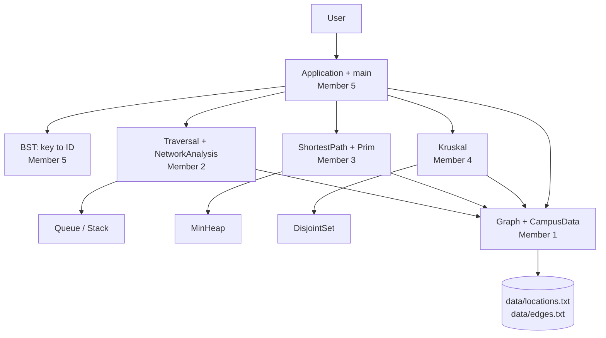

# Design Document: AUC Route Network Analyzer (Milestone 2)

> Each member should check the section about their own module before submission.

## 1. Problem and Approach

Students and visitors need to find their way around AUC, including between floors and without stairs. The campus is modelled as a **weighted, undirected graph**:

- **Vertex** = one navigable point (entrance, room, hallway point, stair or elevator landing on one floor)
- **Edge** = a walkable connection, with an integer cost, a type (corridor, stairs, elevator, ...) and an accessible flag

All algorithms work on integer vertex IDs `0 ... V-1`. People use names, so a Binary Search Tree maps each location's unique search key to its ID.

## 2. Architecture

Rules that keep the modules independent:

- **Only the Application prints to the user.** Algorithms return results and status values.
- **The Graph owns all vertex and edge memory.** Algorithms receive `const Graph&`, read edges through `getNeighbors()` and never delete them.
- **Algorithms never use names.** The Application converts names to IDs before calling them.
- **Output arrays are provided by the caller** (size at least V; V-1 for MST edges). On failure a function returns `false` and sets the length to 0.

### Program flow

1. `main` creates the Graph and calls `loadCampusData()`. If loading fails, it prints an error and exits with code 1.
2. `buildLocationIndex()` inserts every named location's key and ID into the BST. Unnamed waypoints (label `x`) stay in the graph for routing but are not searchable.
3. `runApplication()` shows the menu. Each option reads key(s), looks them up in the BST, calls an algorithm, and prints the result using the Graph's location information.

Example, shortest route: `BST.search(from)`, `BST.search(to)` → `findShortestPath()` (Dijkstra + MinHeap over the Graph) → `displayRoute()` prints labels, floors and floor changes.

## 3. Data Structures

| Structure | Owner | Used for | Why this structure |
|---|---|---|---|
| Graph (adjacency list) | Member 1 | Locations and paths | Campus graphs are sparse: each point has few neighbours, so lists use O(V + E) memory instead of O(V²) for a matrix |
| Queue (linked list) | Member 2 | BFS | FIFO order visits locations level by level |
| Stack (linked list) | Member 2 | Iterative DFS | LIFO order follows one path deep first, with no recursion depth limit |
| Binary MinHeap (array) | Member 3 | Dijkstra, Prim | Always gives the vertex with the smallest tentative cost in O(log n) |
| DisjointSet (union by rank + path compression) | Member 4 | Kruskal | Checks whether an edge would form a cycle in near-constant time |
| BST | Member 5 | Key → vertex ID | Sorted keys give O(log n) average lookup and an alphabetical listing with no extra sort |

No STL container is used as the core of any of these structures.

## 4. Algorithms and Complexity

V = locations, E = connections, h = BST height.

| Operation | Algorithm | Time | Notes |
|---|---|---|---|
| Load data | CampusData | O(V + E) plus duplicate checks | Locations first, then edges |
| Search by key | BST | O(h): O(log V) average, O(V) worst | Worst case if keys are inserted in sorted order |
| Build search index | BST inserts | O(V · h) | |
| BFS / DFS | Queue / Stack | O(V + E) | Each vertex and edge handled once |
| Reachability, components | BFS/DFS | O(V + E) | |
| Degree, isolated, most connected | Adjacency scan | O(V + E) | |
| Shortest / accessible route | Dijkstra + MinHeap | O((V + E) log E) | Heap has no decrease-key: duplicates are inserted and stale entries skipped |
| Nearest amenity | One Dijkstra + scan | O((V + E) log E + V) | Compares by LocationType, not by name |
| Prim MST | MinHeap | O((V + E) log E) | Same duplicate-entry approach |
| Kruskal MST | Merge sort + DisjointSet | O(E log E) | Sorting dominates |

### Shortest path vs minimum spanning tree

- **Dijkstra** answers: what is the cheapest way from *A* to *B*? It is the navigation feature.
- **An MST** answers: what is the cheapest set of connections that keeps *every* location connected? It is a network-analysis feature, for example the minimum corridors to keep open. The path between two locations inside an MST is usually *not* their shortest route.
- Prim and Kruskal may choose different edges when weights tie, but on the same connected graph their **total weight must be equal**. The tests check this.

## 5. Accessibility and Floors

- Each floor's stair or elevator landing is its own vertex. Floors are joined by edges of type STAIRS or ELEVATOR.
- Every edge has an `accessible` flag. Stairs are always inaccessible.
- An accessible route runs Dijkstra with `accessibleOnly = true`, so inaccessible edges are skipped. If no route remains, the app says so rather than showing a route with stairs.
- Accessibility must be verified on site; it is never guessed from coordinates.
- `displayRoute` prints "take the elevator/stairs from X to Y" when consecutive stops are on different floors.

## 6. Data Decisions

- The Milestone 2 dataset is a small SSE-centered sample (about 20–35 vertices) rather than the large supplied dataset.
- Weights are non-negative integers in estimated cost units; they are not labelled as meters until verified.
- Coordinates (x, y) are for display only and are not used as routing weights.
- Each undirected edge appears once in `edges.txt` and is stored in both adjacency lists, but counted once.
- Search keys are unique (for example `SSE_First_Room_101`); labels may repeat (several "Stairs").

## 7. Failure Handling

| Situation | Behaviour |
|---|---|
| Missing or malformed data file | Loader returns false; `main` prints an error and exits with code 1 |
| Duplicate search key | Not added to the BST; a warning is printed at startup |
| Unknown, misspelled or empty key | "Location ... was not found. Use option 1 to see all search keys." |
| Invalid menu choice (letters, out of range, blank) | "Invalid choice"; the menu continues |
| Unreachable destination | "No route from A to B. They are not connected." |
| No accessible route | "No accessible route ... Every route needs stairs or an inaccessible path." |
| No amenity of that type reachable | "No reachable Cafe found." |
| Disconnected graph for MST | "the network is disconnected, so no spanning tree connects every location" |
| Empty graph | Options are refused with "No locations are loaded." |
| End of input (Ctrl+D / end of file) | Program exits cleanly |

## 8. Testing

Each module has its own test in `tests/`, run with `make test`. `test_application.cpp` drives the whole menu with scripted input on a two-floor test graph whose answers were calculated by hand:

- shortest route Entrance → Room 101 = 14 (uses stairs); accessible route = 23 (uses the elevator)
- nearest restroom from the entrance = 17
- an isolated kiosk: unreachable route, 2 components, MST refused
- without the kiosk: Prim and Kruskal both give 7 edges with total weight 25
- invalid keys, empty input, invalid menu numbers and an empty graph

## 9. Trade-offs and Future Work

- **Unbalanced BST:** simple and enough for a small campus, but O(V) in the worst case. An AVL tree would guarantee O(log V).
- **Exact-key search:** reliable, but not friendly. Case-insensitive search or prefix suggestions (possible because the BST keeps keys sorted) could be added.
- **Heap without decrease-key:** simpler code at the cost of up to E heap entries.
- **Future:** more buildings and floors, converting the supplied campus data, and a map visualization.
